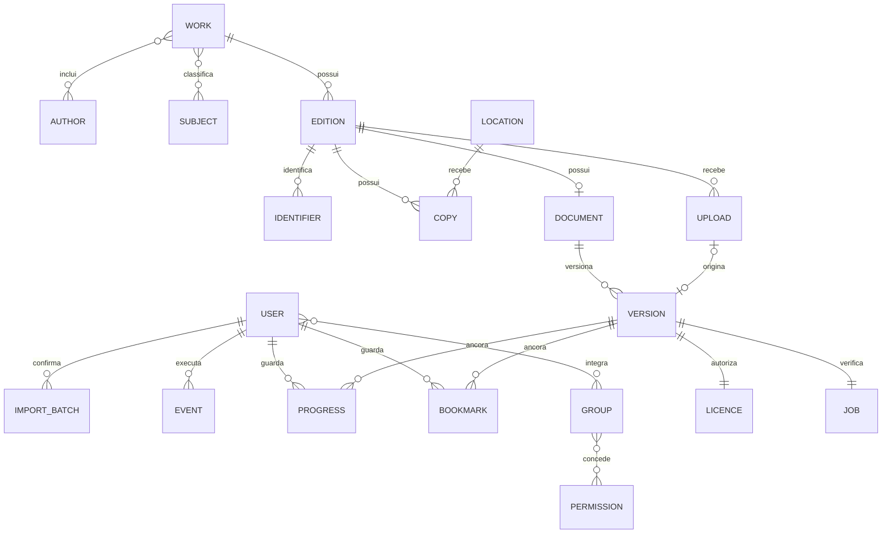

# Modelo de dados

- `User` conserva o número institucional em texto, único e igual ao nome de utilizador. O identificador opaco do futuro fornecedor de identidade é independente do número. `ImportBatch` conserva a referência de origem, o operador e a confirmação. `Attempt` limita tentativas por âmbito e endereço.
- `Work` guarda metadados comuns. `Edition` agrupa identificadores, exemplares e o documento digital de uma edição. Cada `Copy` tem inventário único e uma `Location`.
- `Version` tem UUID, modalidade, referência de autorização, hash, total de páginas e estado editorial. Uma restrição só permite uma versão publicada por documento. `Licence` regista quem documentou a autorização. O original e a cópia de leitura usam chaves derivadas do UUID em armazenamento privado.
- `Job` regista execução, estado e erro. `Upload` conserva o último byte confirmado e o dono da transferência. Os marcadores e os progressos pertencem a um utilizador e a uma versão. `Event` regista actor, área, acção e referência.
